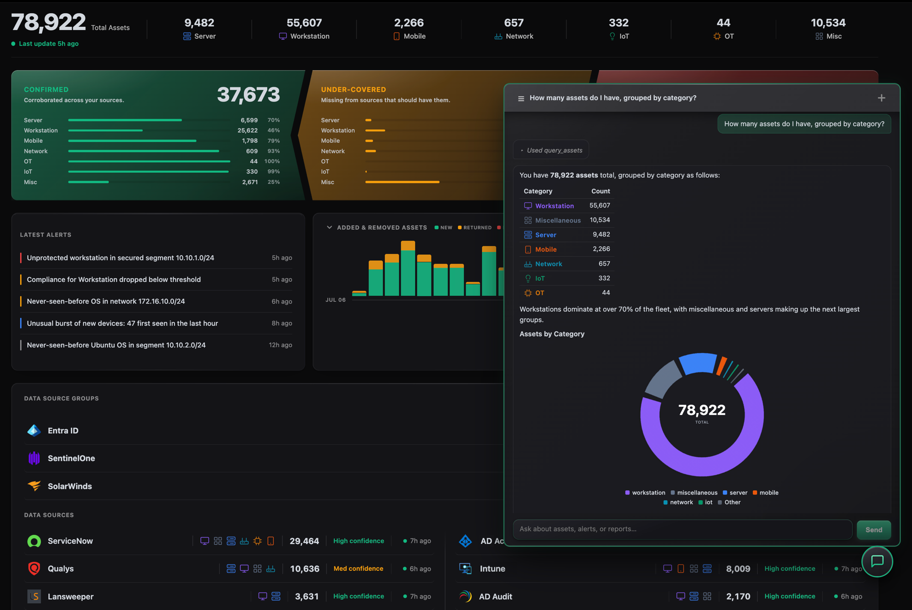

# AssetAtlas

**Know your assets, their behavior, and their risks — just ask.**

Open source, self-hosted, agentless. Bring your own LLM.

We're DOTDNA, a cybersecurity company in Bucharest. AssetAtlas started inside
our own SOC, where we do incident response for enterprise customers: no
organisation we worked with had an inventory we could rely on. The raw material
was always there, scattered across a dozen tools, each holding a piece of the
answer. So we built something to put the pieces together. The matching
algorithm came first; history, rules, alerts, reporting and the LLM integration
followed, driven by our own use cases and by what our customers needed. Today
it runs in production against inventories of thousands of assets.

We're releasing it under AGPL-3.0 because we think others can benefit from what
we built. This repository is the whole product: every feature, no asset limits,
no paid tier.



---

## What it does

**Every tool sees a different machine. AssetAtlas gets them to agree.** No
source sees a whole asset, and turning those partial, overlapping and sometimes
contradictory views into one record is the problem this project exists to solve.

Records are matched on whatever identifiers they happen to carry, so an asset
keeps one identity across runs and accumulates a history — and every record
carries a confidence score, so you know which ones to lean on and which to
check.

**Connects to what you already run.** Endpoint protection, identity providers,
device management, vulnerability scanners, CMDBs, network monitoring and cloud
platforms, plus a generic REST connector and CSV upload for anything else.

**Or read it out of the SIEM or data lake, where it already landed.** Doing
incident response, we spend our days inside our customers' SIEMs and data
lakes, and we saw the same pattern everywhere. Firewall traffic,
authentication events, endpoint telemetry: sources full of usable asset data,
already onboarded and indexed — and nothing was reading any of it for
inventory. The organisation had already paid to collect the data and was
getting no inventory out of it.

So AssetAtlas can take it from there. Point it at **Splunk**, **Microsoft
Sentinel**, **SentinelOne Singularity Data Lake** or **Databricks**, map what
comes back onto the fields that matter for your use cases — often the ones a
CMDB never carried — and it becomes a scheduled source like any other.

**A full history, not just today's snapshot.** Every change is recorded
attribute by attribute, so you can ask what changed, when, and what any asset
looked like at a given moment in the past. If you are investigating an incident,
you can see the machine as it was on the day — not as it is now.

**Ask your inventory questions.** A built-in chatbot answers in plain language,
backed by an LLM you choose — hosted or running locally. Deploy it as a
Microsoft Teams app and you can ask straight from Teams.

AssetAtlas also ships a **Model Context Protocol server** with **37 tools** —
enough to run complex searches across asset fields and their history, work
through alerts, or check the status of the data pipeline. Every one of them is
read-only; there is no write path.

**Rules that keep it useful as it grows.** Tag and classify assets
automatically, score them against your security and compliance expectations, and
raise alerts when something drifts — including machine-learning rules that flag
unusual patterns rather than fixed thresholds.

**Meets enterprise security requirements.** Single sign-on, MFA, role-based access and a
full audit trail.

---

## Quick start

AssetAtlas runs on **Ubuntu** 22.04/24.04, **Debian** 12+ and **RHEL** 9+
(Rocky and AlmaLinux included). There is nothing else to prepare — the
installer brings everything it needs:

```bash
curl -fsSL https://get.assetatlas.com | sudo bash
```

---

## Documentation

The documentation ships **inside the product**. Select the `?` icon in the
sidebar of any page for the help topic covering it.

## Contributing

AssetAtlas is developed internally at DOTDNA, and this repository is a
read-only mirror — we don't accept pull requests. Bug reports and feature
requests are very welcome in
[GitHub Issues](https://github.com/dotdna-io/assetatlas/issues);
[CONTRIBUTING.md](CONTRIBUTING.md) has the details. Please report security
vulnerabilities privately as described in [SECURITY.md](SECURITY.md).

## Versioning

Releases follow `YYYY.WW.N` — year, ISO week, and release number within that
week. The current version is in [`VERSION`](VERSION); see
[CHANGELOG.md](CHANGELOG.md) and
[GitHub Releases](https://github.com/dotdna-io/assetatlas/releases).

## License

AssetAtlas is licensed under the **GNU Affero General Public License v3.0 or
later (AGPL-3.0-or-later)** — see [LICENSE](LICENSE) for the full text.

Copyright (C) 2025-2026 DOT Brainy SRL.

AGPL-3.0 §13 covers network use: if you run a modified version of AssetAtlas as
a network service, you must offer its users the Corresponding Source of your
version.

The license covers the source code only — it does not grant rights to the
AssetAtlas name or logo, which are trademarks of DOT Brainy SRL.
